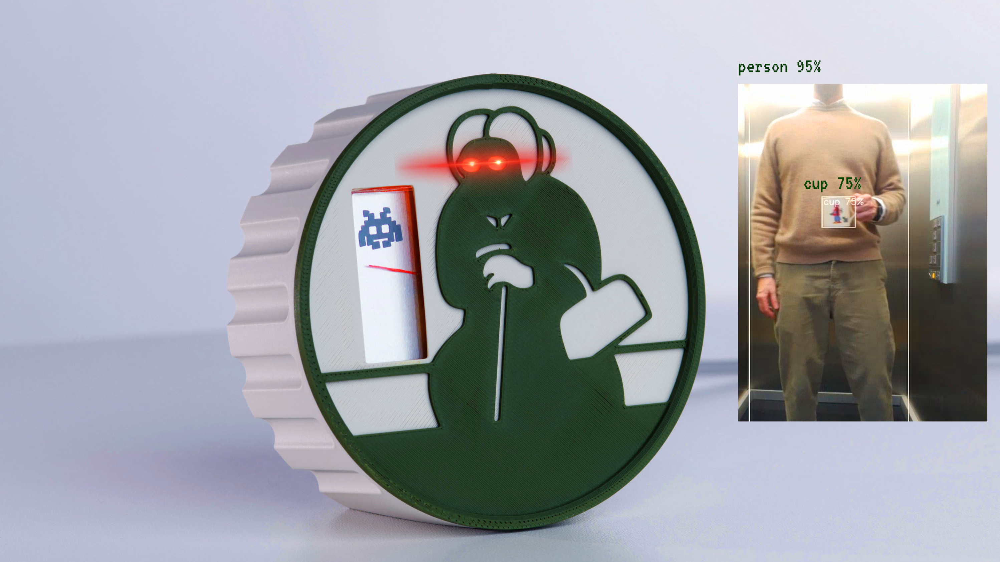

[](https://github.com/veebch/peeperpam/blob/main/images/hildegard_composite.jpg)

[](https://www.youtube.com/channel/UCz5BOU9J9pB_O0B8-rDjCWQ) [](https://github.com/veebch) [](https://www.instagram.com/v_e_e_b/)

# Hildegard

Hildegard watches the corridor so you don't have to. When someone heads for your desk carrying a mug, her eyes turn from green to red, the needle swings towards the space invader and she sounds the alarm. That gives you a few seconds to pick up the phone and pretend to be busy.

Under the grumpy face she's a computer vision sentry. A Raspberry Pi 5 with a camera and a Raspberry Pi AI HAT+ 2 runs object detection and acts as the server. A Pico W inside the enclosure is the client. It listens for detections over WebSocket and drives an RGB LED, an analogue needle and a buzzer.

Hildegard detects every object she can see, but some matter more than others. A person carrying a cup is a 100% alert. A person on their own scores 70%, a cup on its own 30%, and anything else on the watch list 10%.

## Video

[](https://www.youtube.com/watch?v=5TOP2SJovmY)

Hildegard is a rebuild of one of our earlier projects. Here's the [original version](https://www.youtube.com/watch?v=Vn3WaVIr5v0), which had a single red LED.

## Project structure

### Server

`combined_monitor.py` runs on the Raspberry Pi 5. It captures video, runs object detection on the AI HAT+ 2, and broadcasts every detected object with its confidence score over WebSocket.

### Client

`main.py` is a MicroPython WebSocket client for the Pico W. It receives the detection data and responds by priority:

- Person + cup: 100% PWM alert
- Person only: 70% PWM response
- Cup only: 30% PWM response
- Other objects: 10% PWM response

The LED fades from green (0%) to red (100%) as the priority rises.

`config.py` holds the client settings (see below).

## Materials

### Server

- Raspberry Pi 5
- Raspberry Pi AI HAT+ 2
- Camera module

### Detector

- Analogue voltmeter (5V)
- Pico W
- 220 Ohm resistor
- 1K Ohm resistor
- MOSFET (we used a BS170 small signal MOSFET)
- 4 legged RGB LED
- Passive buzzer

### Enclosure

The printable parts are in the [`3d`](3d) folder.

The enclosure is based on the [Old Lady clock](https://www.printables.com/model/953649-creepy-old-lady-from-vienna-clock) by Georg Mierau.

## Assembly

### Server

Fit the AI HAT+ 2 to the Pi 5, then connect the camera with the 22 pin ribbon cable to the CAM/DISP 0 port.

### Detector

- Pico GPIO 27 goes through the 1K Ohm resistor to the gate (middle pin) of the MOSFET.
- The Pico's VSYS pin goes to the positive terminal of the voltmeter.
- The negative terminal of the voltmeter goes to the MOSFET's Drain, and the MOSFET's Source goes to a GND pin on the Pico.
- The LED's cathode (negative) leg goes to a GND pin on the Pico through the 220 Ohm resistor. The red, green and blue legs go to GP18, GP19 and GP20.
- The buzzer's positive terminal goes to GPIO 15 and its negative terminal to GND.

## Installing

### Software for the AI HAT+ 2

Install the AI HAT+ 2 software by following Raspberry Pi's official guide: https://www.raspberrypi.com/documentation/computers/ai.html

### This project

You'll need `rpicam-apps` in your home directory:

```
cd ~
git clone https://github.com/raspberrypi/rpicam-apps
```

Then clone this repository onto the Pi 5:

```
git clone https://github.com/veebch/peeperpam.git
```

## Running

### Start the server

Set up a Python environment and run the monitor:

```
python3 -m venv ~/.venv
source ~/.venv/bin/activate
cd ~/peeperpam
pip install websockets  # Install required WebSocket library
python3 combined_monitor.py
```

This starts the camera monitoring and the WebSocket server that broadcasts the detections.

### Configure and deploy the client

1. Edit `config.py`:
   - Replace `SSID` and `PASSWORD` with your WiFi details.
   - Change the `INTERESTING_OBJECTS` list to watch for different things. By default it draws on the [COCO 80](https://blog.roboflow.com/microsoft-coco-classes/) classes, but you can train on other image data.
   - Adjust `PERSON_SCALE`, `CUP_SCALE` and `OTHER_SCALE` to change the priorities.
   - Tune `SOUND_THRESHOLD`, `SOUND_COOLDOWN` and the UFO sound parameters.
   - Change the pin assignments if your wiring differs.

2. Copy `main.py` and `config.py` to the Pico W with Ampy, Thonny or whatever you prefer.

3. Power on the Pico W. It connects to WiFi and starts receiving detections.

### What to expect

The LED shifts from green to red as the priority of what Hildegard sees goes up, and the needle shows detection confidence scaled by that priority. When confidence passes 50%, she plays the UFO alert, then waits 5 seconds before she'll sound again. If the WebSocket connection drops, the Pico reconnects on its own.

## Caveats

The MOSFET may be overkill for an LED and a voltmeter. Powering the alarm from VSYS through the MOSFET means you can swap in something that draws much more current than a GPIO pin can supply (about 16mA).

## Credits

The design was inspired by a sticker on Austrian trams asking passengers to give up their seat for cool-looking old ladies.

Enclosure based on the Old Lady clock by Georg Mierau.

## Licence

The code is released under GPL-3.0. See [LICENSE](LICENSE).
